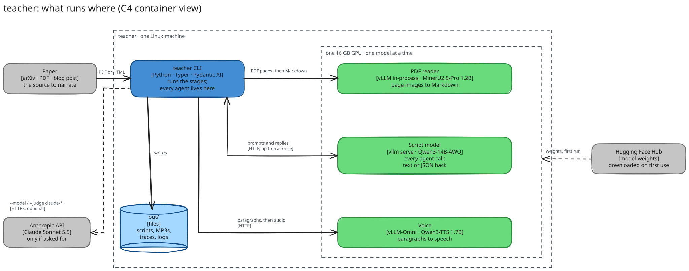
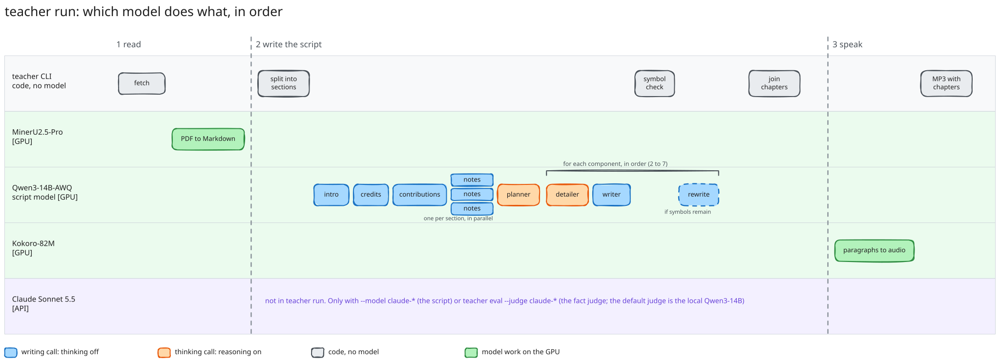

# Teacher

Converts ML/AI papers into an audio only format, like a podcast.

🔥🔥 _This is an experimental repo, I am currently iterating on generating narratives over any engineering work._ 🔥🔥

I am a busy parent, this helps me keep on top of reading: doing the dishes, driving and that sort of thing. No replacement for reading but better than no reading.

## Example episodes

Two episodes made entirely on one local GPU with the default settings (`uv run teacher run <pdf>`): no API calls. Each is the abstract read for the ear, the contributions in plain English, then how the method works.

| Paper | Listen | Script |
|---|---|---|
| [Continuous Autoregressive Language Models (CALM)](https://arxiv.org/abs/2510.27688) | [MP3, 14 min](episodes/calm-2510.27688.mp3) | [script](episodes/calm-2510.27688.md) |
| [Self-Supervised Learning from Images with a Joint-Embedding Predictive Architecture (I-JEPA)](https://arxiv.org/abs/2301.08243) | [MP3, 12 min](episodes/i-jepa-2301.08243.mp3) | [script](episodes/i-jepa-2301.08243.md) |

GitHub can't play audio inside a README: the MP3 link opens the file page, where "View raw" plays it in the browser or downloads it. PDFs and MP3s are stored with [Git LFS](https://git-lfs.com), so run `git lfs install` before cloning to get the files rather than pointers.

## How it works

Everything runs locally on one NVIDIA GPU (developed on an RTX 5070 Ti, 16 GB), with one model on the GPU at a time.

1. **Read**: a PDF goes through [MinerU](https://github.com/opendatalab/MinerU). It finds the page layout, then its `MinerU2.5-Pro` 1.2B vision model, on an in-process [vLLM](https://github.com/vllm-project/vllm) engine, reads each region. The result is Markdown with LaTeX equations, HTML tables and algorithm boxes; figures are dropped but their captions kept. Blog posts go through [trafilatura](https://github.com/adbar/trafilatura). Everything from the references on is cut (which, for now, includes any appendix).
2. **Write**: a `vllm serve` subprocess runs the script model (Qwen3-14B-AWQ), and [Pydantic AI](https://ai.pydantic.dev) agents write the script. Each agent is one fixed system prompt and a typed output, used for single-turn calls; plain Python decides what to call next. Independent calls run in parallel (`PARALLEL` in `settings.py`) so vLLM can batch them. The episode has three parts, each given everything the listener has already heard, so it builds on it instead of repeating it:
   - **Abstract**: the text under the abstract heading, transcribed for the ear: symbols, numbers and acronyms in spoken form, nothing else changed. A transcription that keeps under 80% of the original words, or keeps symbols, is made again.
   - **Contributions**: from the abstract, introduction and conclusion, each contribution in plain English (the problem, what was done before, what is new), for a listener who knows ML but not the subfield.
   - **How it works**, so that the listener could implement it. The source is split at its headings into sections ([semchunk](https://github.com/isaacus-dev/semchunk) splits any over `--chunk` tokens); a note-taker summarises each, and a planner (thinking on) outlines the method as a glossary of plain names and two to seven components, each naming the sections it draws on. For each component, a detailer (thinking on) rewrites its inputs, steps and outputs from the full text of those sections, and one part is written from it. Each part is checked by a round trip: a listener agent writes pseudocode from the narration alone, and a checker (thinking on) compares it with the component and the source; any word with a digit or symbol in it is also a problem, found by a regex. A part with problems is rewritten once.
3. **Speak**: [Qwen3-TTS](https://huggingface.co/Qwen/Qwen3-TTS-12Hz-1.7B-CustomVoice) (1.7B, Apache-2.0) on a [vLLM-Omni](https://github.com/vllm-project/vllm-omni) server reads the script, a batch of paragraphs per request, with the model's own delivery: no style instruction, since one made the voice and tone drift between paragraphs (`teacher speak --style` sends `prompts/voice.md`).

### Models and agents

Every model, where it runs, and every agent that calls it. **Thinking** agents run with the model's reasoning on (Qwen3's thinking mode, or Claude at effort high); **writing** agents run with it off (Claude at effort low). Agents with a typed output use JSON-schema structured output.

What runs where: the teacher CLI holds every agent, and each model runs on the one GPU in turn, or on the Anthropic API for evals.



Which model does what during `teacher run`, in order. Blue calls run with thinking off, orange with it on.



Both diagrams are drawn in [Excalidraw](https://excalidraw.com). Each SVG in `docs/` has its scene embedded, so it opens for editing in Excalidraw or its VS Code extension, and the `.excalidraw` file beside it is the same scene as plain JSON.

| Agent | Prompt | Mode | Output |
|---|---|---|---|
| Abstract reader | `episode/abstract` | writing | `Abstract` |
| Contributions writer | `episode/contributions` | writing | `Contributions` |
| Section notes | `plan/section_notes` | writing | text |
| Planner | `plan/planner` | thinking | `Method` |
| Detailer | `plan/detailer` | thinking | `Detail` |
| Splitter | `tree/splitter` | thinking | `Split` |
| Note-taker | `tree/note_taker` | writing | `Notes` |
| Notes verifier | `tree/notes_verifier` | thinking | `Problems` |
| Writer | `part/writer` | writing | text |
| Listener | `part/listener` | writing | `Reconstruction` |
| Checker | `part/checker` | thinking | `Problems` |
| Judge | `eval/judge` | thinking, always Claude | `Verdict` |

### The outline tree (in progress)

`teacher run` plans the method from short notes, which loses things. Its replacement, not yet wired into `run`, breaks the source down the way you would by hand:

1. **Top level**: the source's own top-level sections, found from heading numbers in code.
2. **Recursion**: for each section, a splitter (thinking on) reads its text and lists its subsections, each as a title and the exact words it starts with, or none if it is one idea. It writes nothing else. Code cuts the text at those words, and each piece is broken down in turn, until it is one idea, under 1,500 characters, or four levels deep.
3. **Narration** of a node, leaf by leaf: a note-taker writes one fact per item from the leaf's text, and a separate verifier (thinking on) lists what the notes miss or get wrong against the text; the note-taker revises until the verifier finds nothing, or for at most three rounds. A part is then written from the notes, listened to and checked as above.

`teacher outline` builds the tree, `teacher write` narrates one node of it, and `teacher eval` scores narrations against facts (see [Iterating on prompts](#iterating-on-prompts)).

## Code

[`commands/run.py`](src/teacher/commands/run.py) is the place to start: it reads as the data flow, one line per stage. Each command is one thin file in `commands/`, registered in [`cli.py`](src/teacher/cli.py); the work is in the modules below it, which import only each other's public names.

| Module | Does |
|---|---|
| `commands/` | `run`, `outline`, `write`, `eval` (`evaluate.py`) and `serve`: options, files in and out, nothing else |
| `source.py` | Fetch a path or URL, convert a PDF (MinerU), HTML (trafilatura) or Markdown file, cut the references |
| `episode.py` | The `run` script: chunking, abstract, contributions, then notes → planner → detailer → a checked part per component |
| `tree.py` | The outline tree: top-level sections, recursive splitting, the notes loop, narrating a node |
| `part.py` | One checked spoken part, shared by both: writer → listener → checker → one rewrite; the `Brief` it is written from |
| `judge.py` | The fact judge for `eval`, and the check that its quote is in the narration |
| `llm.py` | Talking to the model: `agent(name)`, `ask` (one traced call), `ask_until` (ask, check, ask again with the problems), `parallel` |
| `speech.py` | Strip markup into paragraphs, synthesise them, write `.md` and `.mp3`; the check for words TTS reads badly |
| `servers.py` | Start a vLLM or vLLM-Omni server for the length of a `with` block, or use a running one |
| `settings.py` | Models, limits, server flags, sampling, parallelism, environment |

## Prompts

Everything the models see is in `src/teacher/prompts/`, as [Jinja2](https://jinja.palletsprojects.com) templates, one folder per stage. An agent named `part/writer` has `part/writer.md` as its instructions, starting with a `# Title` line, and `part/writer_task.md` as the message of each call, built from tagged blocks such as `<source>`, `<heard>`, `<draft>` and `<problems>`. Blocks used by more than one prompt are in `_shared/` and pulled in with ``: the spoken-output rules (`spoken.md`), the plain-words rule for notes and plans (`plain.md`), the problems from a check (`problems.md`), and the component and outline blocks.

| Folder | Agents | Used by |
|---|---|---|
| `episode/` | `abstract` reader, `contributions` writer | `run` |
| `plan/` | `section_notes`, `planner`, `detailer` | `run` |
| `tree/` | `splitter`, `note_taker`, `notes_verifier` | `outline`, `write`, `eval` |
| `part/` | `writer`, `listener`, `checker` | `run`, `write`, `eval` |
| `eval/` | `judge` | `eval` |
| `voice.md` | a speaking-style instruction for TTS, off by default | `speak --style` |

## Usage

```bash
uv run teacher run https://arxiv.org/abs/2510.27688 --minutes 20   # script and MP3
uv run teacher run paper.pdf --no-audio                             # script only
```

`teacher run` takes a PDF path, PDF URL, arXiv abs URL or blog post URL.

| Option | Default | |
|---|---|---|
| `--model` | `Qwen/Qwen3-14B-AWQ` | The script model: a Hugging Face model that vLLM serves, or `claude-*` on the Anthropic API (see [Models](#models)) |
| `--voice` | `ryan` | Qwen3-TTS speaker; `aiden` is the other native English voice |
| `--minutes` | `25` | Upper limit on the length of the audio. Each method part's word target comes from the outline (capped at 300 words) and only shrinks if the total does not fit |
| `--chunk` | `4000` | Max source tokens per section; longer sections are split. Lower it if vLLM rejects a call as too long |
| `--no-audio` | off | Stop after the script |
| `--server` | none | URL of a running `teacher serve`; skips starting vLLM |
| `--out` | `out/run` | Output directory |

`teacher run` sets these environment variables unless you set them yourself:

| Variable | Value | Why |
|---|---|---|
| `VLLM_USE_FLASHINFER_SAMPLER` | `0` | FlashInfer compiles with the system `nvcc`, and Blackwell GPUs need CUDA ≥ 12.9 |
| `MINERU_PROCESSING_WINDOW_SIZE` | `8` | Pages held in RAM at once |
| `TORCHINDUCTOR_COMPILE_THREADS` | `1` | Keeps the vLLM compile step's RAM down |
| `MINERU_TELEMETRY_DISABLED` | `1` | MinerU sends usage telemetry by default |

## Models

Each model family has a profile in `settings.PROFILES`, matched by the start of the model's name: its `vllm serve` flags, and the model settings for agents that write and for agents that plan or check. `Qwen/Qwen3-` is set up for local vLLM; `claude-` runs on the Anthropic API, with effort `low` for writing and `high` for planning and checking, and a server-side fallback model if Claude declines a request. To try another family, add its profile; an unknown family stops with an error naming `PROFILES`.

Claude models need an Anthropic API key, read from the `CLAUDE_API_KEY` environment variable or a `CLAUDE_API_KEY=...` (or `export CLAUDE_API_KEY=...`) line in the repo's `.env`, which git ignores.

## Outputs

Everything a command writes goes under `out/`, which git ignores:

| Path | Written by | Contents |
|---|---|---|
| `out/run/<name>.md`, `.mp3` | `run` | The script and the audio |
| `out/<command>/<name>.trace.jsonl` | every command | Every model call, one JSON line each: the agent (such as `part/writer`), the model, the message, the reply, any error, its seconds, and its input and output tokens. Also each server's startup seconds and, for `run`, the seconds of each stage (read, write, speak), for benchmarking. The first place to look when a part comes out wrong |
| `out/outline/<name>.outline.md`, `.json` | `outline` | The nested headings; the tree with each node's text |
| `out/write/<name>.<node>.md` | `write` | The narration of one node |
| `out/eval/<time>.md` | `eval` | The score table, each narration, and each fact's verdict with the judge's quote |
| `out/<command>/script-model.log`, `voice-model.log`, `out/serve.log` | servers | vLLM logs |

## Setup

Requires Linux, an NVIDIA GPU, and about 8 GB of free RAM.

```bash
uv sync
```

Model weights download on first use: MinerU's to `~/.mineru`, the others to `~/.cache/huggingface`. Each vLLM engine compiles on its first start, which takes a few minutes; later starts take about 30 s to 2 min. Server logs are written next to each command's outputs (see [Outputs](#outputs)).

## Iterating on prompts

A full `teacher run` takes a quarter of an hour or more. To change a prompt and see the effect in minutes:

```bash
uv run teacher serve                     # once, in its own terminal: keeps the script model on the GPU
uv run teacher eval --server http://127.0.0.1:8000                    # every case, about 3 minutes
uv run teacher eval --server http://127.0.0.1:8000 --only "energy"    # one case, about a minute
uv run teacher write evals/trees/2510.27688v1.outline.json --node "3.3.2" --server http://127.0.0.1:8000
uv run teacher outline paper.pdf --server http://127.0.0.1:8000       # a new tree; also takes a .md file
```

`evals/cases.json` lists nodes of two papers, each with three to six facts its narration must state; `evals/trees/` holds the outline trees they come from, kept fixed so runs are comparable. `teacher eval` narrates each node with `--model`, and a fixed judge (`settings.JUDGE_MODEL`, Claude Sonnet 5.5, whatever model narrates) checks one fact per call: `stated`, `missing` or `contradicted`, with a quote from the narration that code checks is really there. A verdict whose quote is not in the narration counts as missing. The score varies from run to run, because each run writes new narrations, so judge a prompt change by a clear shift in the total, not by single facts. `--note-rounds 0` turns off the notes verifier, to measure what it adds. `--model claude-sonnet-5-5` narrates with Claude instead of the local model: a ceiling run, to see how much of the gap is the model and how much the prompts. Model calls in flight are capped at `PARALLEL` across all threads.

## Development

```bash
make test             # unit tests: under 2 seconds, offline, no GPU
make test-functional  # functional tests: real MinerU, Qwen3-TTS, tokenizer and server processes; minutes, on the GPU
make test-all         # both
make coverage         # unit tests with a coverage report: missing lines in the terminal, and htmlcov/index.html
make check            # ruff format and lint
```

Unit tests are for feedback on every change: plain `uv run pytest` runs only them. They run in airplane mode: a socket to anything but loopback fails the test. The script model is a pydantic-ai FunctionModel whose replies follow each agent's phase, speech returns silence, tokens are counted as words, and the CALM PDF reads as `tests/data/calm-short.md`, a short version of MinerU's Markdown of it (`tests/data/calm.md`). Tests that only read what a default run did share one run (the `episode_run` fixture), since each stub call costs about 3 ms of pydantic-ai.

A test that needs a real model, the GPU, the network or real processes and signals is marked `@pytest.mark.functional`. One of them checks that MinerU still converts the PDF to `tests/data/calm.md`'s headings; if MinerU's output changes, save the new output there. Stop `teacher serve` before `make test-functional` (`pkill -f "teacher serve"`), since its tests load models on the GPU.

`tests/` mirrors `src/teacher/`: `tests/test_tree.py` specifies `tree.py`, `tests/commands/test_run.py` specifies `commands/run.py`, and so on. Shared fixtures are in `tests/conftest.py`. Helpers that tests call directly are in `src/teacher/testing.py`: tests run in pytest's `importlib` import mode, where test modules cannot import each other, and pytest's docs recommend keeping such utilities with the library code. Coverage leaves that file out.

## Development plan

- Wire the outline tree into `teacher run`: choose the method's branches, narrate their leaves in order, and give each parent a short spoken signpost of its parts.
- Keep the appendix: cut only the reference list, so implementation details (such as I-JEPA's Appendix A) reach the outline.
- Benchmark vLLM against TensorRT-LLM for the script model on this GPU: throughput, time per episode, and eval score. Check first that TensorRT-LLM runs a 4-bit AWQ model on consumer Blackwell (SM120); one report says only vLLM and SGLang do, through Marlin.
- A steadier eval: run each case several times, and take a majority of three judge verdicts per fact.
- Narration fixes the eval points at: symbols spelled out as words ("mu", "g phi"), and estimator details (weights, signs, sums) that the notes verifier lets through.
